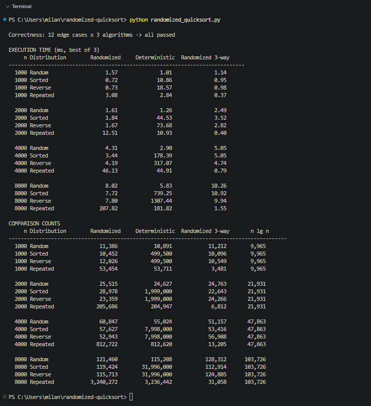

# Randomized Quicksort vs. Deterministic Quicksort

This project compares Randomized Quicksort with a version that always uses the first element as its pivot. It also includes a three-way version for arrays with many repeated values. The Python script runs correctness tests and benchmarks.

## What's here

| File | Purpose |
|---|---|
| `randomized_quicksort.py` | All three sorts, the tests, and the benchmarks |
| `results.txt` | Output from one full run |

## Requirements

Python 3.8 or newer. The code uses only the standard library: `random`, `sys`, `time`, and `math`.

## Running it

```bash
python randomized_quicksort.py
```

The tests run first. If a test fails, the script exits with a nonzero status. Otherwise, it prints timing and counter tables. A full run takes about three minutes on the machine used for these results. Most of that time comes from the first-pivot sort on ordered arrays of 8,000 elements.

To save the output:

```bash
python randomized_quicksort.py > results.txt
```

## Result



## Implementations

**`randomized_quicksort(arr, counter=None)`** uses Lomuto partitioning. It chooses a pivot uniformly at random from each subarray. With distinct keys, its expected time is `O(n log n)` for any fixed input order.

**`deterministic_quicksort(arr, counter=None)`** uses the same partition method but always chooses the first element. Sorted and reverse-sorted input takes `Θ(n²)` time. This version is the comparison baseline.

**`randomized_quicksort_3way(arr, counter=None)`** chooses a random pivot and groups smaller, equal, and larger values. It does not sort the equal group again, so it handles many repeated values well.

All three sorts change the input list in place. The optional `counter` is off during timing runs. For the two-way sorts, it counts element comparisons. In the three-way sort, it increases once per examined element; some elements are tested against the pivot twice. The three-way counter is therefore not a count of every `<` and `>` comparison.

### Bounded stack depth

Each sort recurses on its smaller partition and loops over the larger one. This keeps recursion depth at `O(log n)` for every input. A version that recurses on both sides could hit CPython's recursion limit on a large sorted array. Limiting stack depth does not remove the `Θ(n²)` running time of bad partitions.

## Edge cases tested

The tests compare each result with Python's `sorted()` and check that it has the same elements as the input. The twelve cases are: empty, one element, two elements, all identical, two distinct values, already sorted, reverse sorted, many duplicates, negatives and zero, floats, strings, and a random array. Passing `None` is tested separately and must raise `TypeError`.

## Results

These results come from one machine. Times will vary on another computer. Random pivot choices can also change the counter values between runs.

### Execution time (ms, best of 3)

| n / Distribution | Randomized | Deterministic | Randomized 3-way |
|---|---:|---:|---:|
| 1,000 Random | 1.02 | 0.72 | 1.30 |
| 1,000 Sorted | 0.98 | 12.91 | 1.16 |
| 1,000 Reverse | 0.91 | 22.26 | 1.35 |
| 1,000 Repeated | 3.67 | 3.42 | 0.24 |
| 4,000 Random | 4.68 | 3.57 | 5.91 |
| 4,000 Sorted | 5.78 | 197.54 | 5.74 |
| 4,000 Reverse | 4.37 | 354.96 | 5.82 |
| 4,000 Repeated | 52.71 | 51.94 | 1.02 |
| 8,000 Random | 10.65 | 8.12 | 13.14 |
| 8,000 Sorted | 9.20 | 811.45 | 12.34 |
| 8,000 Reverse | 9.16 | 1411.23 | 12.16 |
| 8,000 Repeated | 204.46 | 193.32 | 1.78 |

### Comparison counters

| n / Distribution | Randomized | Deterministic | 3-way | n log₂ n |
|---|---:|---:|---:|---:|
| 1,000 Sorted | 10,011 | 499,500 | 10,450 | 9,965 |
| 1,000 Repeated | 53,516 | 53,711 | 3,047 | 9,965 |
| 8,000 Random | 121,389 | 115,208 | 124,907 | 103,726 |
| 8,000 Sorted | 121,296 | 31,996,000 | 125,275 | 103,726 |
| 8,000 Reverse | 126,445 | 31,996,000 | 119,333 | 103,726 |
| 8,000 Repeated | 3,229,952 | 3,236,442 | 29,508 | 103,726 |

The three-way column counts examined elements, as explained above. It should not be compared as an exact element-comparison count with the two-way columns.

## Findings

**Random pivots help on ordered input.** On a sorted array of 8,000 elements, the first-pivot sort made 31,996,000 comparisons, exactly `n(n − 1)/2`. The random-pivot sort made 121,296 in this run, about 264 times fewer. Its time fell from 811 ms to 9 ms. Random pivots give good *expected* time for distinct keys, although an unlucky run can still take quadratic time.

**Measured counts are close to the distinct-key prediction.** The indicator-variable analysis gives an expected count of `2(n + 1)Hₙ − 4n`, where `Hₙ` is the nth harmonic number. The random-input measurements were:

| n | Measured | Predicted | Difference |
|---|---:|---:|---:|
| 1,000 | 10,904 | 10,986 | −0.7% |
| 2,000 | 24,330 | 24,730 | −1.6% |
| 4,000 | 53,490 | 54,989 | −2.7% |
| 8,000 | 121,389 | 121,051 | +0.3% |

The formula is exact for distinct keys. The random generator can produce repeats, so it is an approximate comparison point for these arrays.

**Random pivots do not solve the repeated-value problem.** With only ten possible values at `n = 8,000`, the two-way sorts made 3,229,952 and 3,236,442 comparisons. Equal values remain together after a two-way partition. If the ten values form roughly equal groups, equal-key pairs alone account for about `n²/(2 × 10) = 3,200,000` comparisons. The three-way sort recorded 29,508 examined elements and ran about 115 times faster than the randomized two-way sort. Its counter uses the different rule noted above.

**Random pivot selection has a cost.** On random input at `n = 8,000`, the first-pivot sort took 8.12 ms and the random-pivot sort took 10.65 ms in this run. Calling `random.randint` adds work. Three timing runs do not establish a stable percentage difference across machines.

**The same comparison count can take different amounts of time.** The first-pivot sort made 31,996,000 comparisons on both sorted and reverse-sorted input, but took 811 ms and 1,411 ms. The reverse-sorted run caused more exchanges. The comparison count does not measure that work.

**Three-way partitioning adds work when values rarely repeat.** In this run it took about 20–35% longer than the plain random-pivot sort on random and sorted arrays. It must classify values into three groups. Its large gain on repeated values may be worth that cost when duplicates are common.

## References

Bentley, J. L., & McIlroy, M. D. (1993). Engineering a sort function. *Software: Practice and Experience, 23*(11), 1249–1265.

Cormen, T. H., Leiserson, C. E., Rivest, R. L., & Stein, C. (2022). *Introduction to algorithms* (4th ed.). MIT Press.

Musser, D. R. (1997). Introspective sorting and selection algorithms. *Software: Practice and Experience, 27*(8), 983–993.

Sedgewick, R. (1978). Implementing quicksort programs. *Communications of the ACM, 21*(10), 847–857. https://doi.org/10.1145/359619.359631

